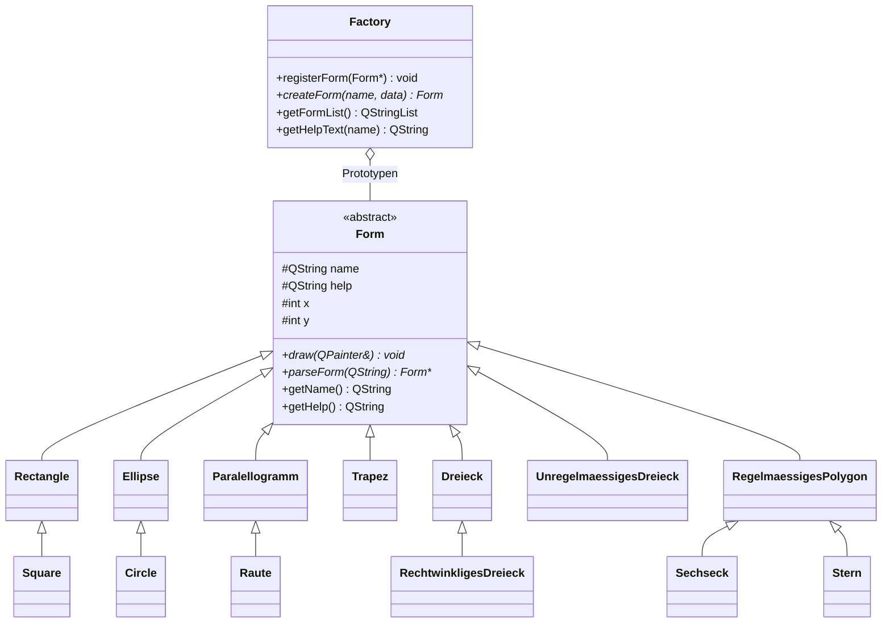

# Aufgabe 5 – Formen (Factory, Vererbung, Libraries statt Plugin)

Zurück: [00 Qt Cheat-Sheets Übersicht](00%20Qt%20Cheat-Sheets%20%C3%9Cbersicht.md) · Konzepte (Vererbung!): [01 Konzepte C++ einfach erklärt](01%20Konzepte%20C%2B%2B%20einfach%20erkl%C3%A4rt.md#5-vererbung)
Mein Projekt: `/Users/justin/Downloads/Formen_Lib_Version` (Referenz mit allen draws: Unterordner `Loesung_zum_Nachschauen`)

**Ziel:** Weitere Formen bei der Factory registrieren. Klassenhierarchie von der abstrakten Klasse `Form` für: Rechteck, Quadrat, Kreis, Trapez, Parallelogramm, Dreieck, Sechseck, Raute, Polygon, Stern, Ellipse. **UML-Klassendiagramm** zeichnen.

**Was gelernt wird:** Vererbung, abstrakte Klassen, virtual, Polymorphie, Factory-Pattern, QPainter, Trigonometrie, mehrere Libraries in einem Subdirs-Projekt.

---

## Die drei Projekte (Bild im Kopf)
- **Formen_Factory (Lib):** Basis. Abstrakte Klasse `Form` + `Factory`. Kennt **keine** konkrete Form.
- **Formen_Plugin (Lib):** Hier liegen die Formen (`Rectangle`, `Trapez` …) + `register.cpp`, die alle bei der Factory anmeldet. **Hier arbeitest du.**
- **Formen (App):** Fenster mit ComboBox, Eingabefeld, Button. Lässt die Factory Objekte bauen und ruft `draw()` auf.
- **Stempel-Bild:** Factory = Stempelkissen mit Vorlagen. Plugin legt Vorlagen hinein. App drückt den Stempel.

## Ablauf beim Start
1. App: `factory = new Factory();`
2. App: `registerForm(factory);` → Plugin meldet für jede Form **ein Prototyp-Objekt** an: `factory->registerForm(new Rectangle());`
3. App: `ui->form_select->insertItems(0, factory->getFormList());` → ComboBox voll
4. Klick: `factory->createForm(name, text)` → sucht Prototyp → ruft `prototyp->parseForm(text)` → **neues** Objekt
5. Objekt in Liste, `update()` → `paintEvent` ruft für jedes `draw(painter)` auf

---

## Plugin → Library umbauen (falls Angabe wieder Plugins hat)
1. **Root-`.pro`** (Subdirs) anlegen:
```
TEMPLATE = subdirs
CONFIG += ordered
SUBDIRS = Formen_Factory Formen_Plugin Formen
```
2. In **Factory-** und **Plugin-`.pro`**: `DESTDIR = $$PWD/../lib` (alle Libs in einen Ordner)
3. Plugin-`.pro`: `LIBS += -L$$PWD/../lib -lFormen_Factory`
4. `register.h`: `extern "C"` entfernen → normale Funktion `PLUGIN bool registerForm(Factory *factory);`
5. App-`.pro`:
```
INCLUDEPATH += $$PWD/sdk/include/ $$PWD/../Formen_Plugin
LIBS += -L$$PWD/../lib -lFormen_Plugin -lFormen_Factory
QMAKE_RPATHDIR += $$PWD/../lib
```
6. App-`mainwindow.cpp`: `load_plugins()` + `QLibrary` + `QDir` löschen, stattdessen:
```cpp
#include "register.h"
// im Konstruktor:
factory = new Factory();
registerForm(factory);
ui->form_select->insertItems(0, factory->getFormList());
```
7. In Qt Creator **`Formen_Gesamt.pro`** öffnen (die oberste!), Run-Ziel = **Formen** (App)

---

## Die Basisklasse `Form` (gegeben)
```cpp
class Form {
protected:                    // Kinder dürfen ran
    QString name, help;
    int x, y;
public:
    Form(const QString name, const QString help, int x, int y);
    virtual void draw(QPainter &painter) = 0;               // MUSS jede Form haben
    virtual Form *parseForm(const QString &data) = 0;       // MUSS jede Form haben
    const QString &getName();
    const QString &getHelp();
};
```

---

## Neue Form anlegen – Vorlage (z. B. Rectangle)

### `rectangle.h`
```cpp
#ifndef RECTANGLE_H
#define RECTANGLE_H
#include "register.h"

class PLUGIN Rectangle : public Form
{
protected:
    int width;
    int height;
public:
    Rectangle(int x = 0, int y = 0, int width = 0, int height = 0);   // Defaults, damit new Rectangle() geht
    void draw(QPainter &painter);
    Form *parseForm(const QString &data);
};
#endif
```

### `rectangle.cpp`
```cpp
#include "rectangle.h"

Rectangle::Rectangle(int x, int y, int width, int height)
    : Form("Rectangle", "Datenformat: x,y,breite,hoehe", x, y), width(width), height(height)
{
}

void Rectangle::draw(QPainter &painter)
{
    painter.setPen(QPen(Qt::black, 2, Qt::SolidLine, Qt::RoundCap));
    painter.drawRect(x, y, width, height);
}

Form *Rectangle::parseForm(const QString &data)
{
    QStringList d = data.split(",");
    if (d.size() == 4)
        return new Rectangle(d[0].toInt(), d[1].toInt(), d[2].toInt(), d[3].toInt());
    return nullptr;                                  // falsche Eingabe → nichts zeichnen
}
```

### `register.cpp`
```cpp
#include "rectangle.h"
...
factory->registerForm(new Rectangle());
```

### Checkliste beim Kopieren einer Klasse (meine Hauptfehlerquelle!)
1. `.h`: Include-Guard, **Klassenname**, Basisklasse, Member, Konstruktor
2. `.cpp`: `#include "neu.h"`, **`Neu::Neu(...)`**, **Name im `Form("Neu", …)`**, Hilfetext, Init-Liste
3. `draw`: **`Neu::draw`**, richtige Member
4. `parseForm`: **Feldanzahl** `d.size() == n`, **`new Neu(...)`** mit allen Werten
5. `register.cpp`: Include + `registerForm(new Neu())`
6. `.pro`: Dateien unter `SOURCES` / `HEADERS` (macht Qt Creator beim Anlegen meist selbst)
7. **Cmd+S → Cmd+B → testen**

---

## Vererbte Form – kein eigenes draw (z. B. Square)
```cpp
// square.h
#include "rectangle.h"
class PLUGIN Square : public Rectangle
{
public:
    Square(int x = 0, int y = 0, int seite = 0);
    Form *parseForm(const QString &data);
};

// square.cpp
Square::Square(int x, int y, int seite) : Rectangle(x, y, seite, seite)   // Eltern bauen lassen
{
    name = "Square";                          // protected → darf ich überschreiben
    help = "Datenformat: x,y,seite";
}
Form *Square::parseForm(const QString &data)
{
    QStringList d = data.split(",");
    if (d.size() == 3) return new Square(d[0].toInt(), d[1].toInt(), d[2].toInt());
    return nullptr;
}
```
- Gleiches Muster: `Circle : Ellipse(x, y, r, r)` · `Raute : Paralellogramm(x, y, seite, seite, winkel)` · `Sechseck : RegelmaessigesPolygon(x, y, radius, 6)`
- **`parseForm` muss trotzdem überschrieben werden**, sonst erwartet Square 4 Felder und baut ein Rectangle.

---

## draw-Bausteine

### QPainter Grundlagen
```cpp
painter.setPen(QPen(Qt::black, 2, Qt::SolidLine, Qt::RoundCap));
painter.drawRect(x, y, breite, hoehe);                              // Rechteck
painter.drawEllipse(x - rx, y - ry, 2 * rx, 2 * ry);                // Ellipse, x,y = Mittelpunkt
QPolygon p;  p << QPoint(..) << QPoint(..);  painter.drawPolygon(p); // alles mit Ecken
```
- **y wächst nach unten!** `y + h` = weiter unten.
- **Punkte einmal um die Form herum** angeben (Finger am Rand entlang). Sonst Sanduhr. Bei 3 Punkten egal.
- `QPoint(int, int)` → bei `double` mit `qRound(...)` runden (oder `QPointF` + `QPolygonF`).

### Trapez (gleichschenklig, `x,y` = links oben)
```cpp
int versatz = (unten - oben) / 2;
QPolygon p;
p << QPoint(x + versatz, y)              // oben links
  << QPoint(x + versatz + oben, y)       // oben rechts
  << QPoint(x + unten, y + hoehe)        // unten rechts
  << QPoint(x, y + hoehe);               // unten links
```

### Dreieck (gleichschenklig)
```cpp
p << QPoint(x + breite / 2, y) << QPoint(x + breite, y + hoehe) << QPoint(x, y + hoehe);
```
- Rechtwinklig: `(x, y)`, `(x, y + hoehe)`, `(x + breite, y + hoehe)`
- Unregelmäßig: drei freie Punkte `(x, y)`, `(x2, y2)`, `(x3, y3)`

### Parallelogramm / Raute (Trigonometrie)
- Rechtwinkliges Dreieck an der Seite: schräge Seite `b` (Hypotenuse), Winkel `α`
  - `h = b · sin(α)` (Gegenkathete)
  - `L1 = b · cos(α)` (Ankathete = Versatz)
  - **SOH-CAH-TOA**: Sin = G/H · Cos = A/H · Tan = G/A
```cpp
#include <QtMath>
double rad = qDegreesToRadians(winkel);      // Grad → Bogenmaß! (= winkel * M_PI / 180.0)
double h  = breite * qSin(rad);              // bei mir: breite = schräge Seite
double l1 = breite * qCos(rad);
p << QPoint(qRound(x + l1), y)                      // oben links
  << QPoint(qRound(x + l1 + laenge), y)             // oben rechts
  << QPoint(x + laenge, qRound(y + h))              // unten rechts
  << QPoint(x, qRound(y + h));                      // unten links
```

### Regelmäßiges Polygon (`x,y` = Mittelpunkt)
```cpp
for (int i = 0; i < ecken; i++) {
    double rad = qDegreesToRadians(-90.0 + i * 360.0 / ecken);   // -90 → erste Ecke oben
    p << QPoint(x + qRound(radius * qCos(rad)), y + qRound(radius * qSin(rad)));
}
```
- Punkt auf einem Kreis: `(mx + r·cos(w), my + r·sin(w))`

### Stern
```cpp
int n = 2 * ecken;                                    // Spitzen + Täler
for (int i = 0; i < n; i++) {
    double r = (i % 2 == 0) ? radius : radius / 2.0;  // abwechselnd außen / innen
    double rad = qDegreesToRadians(-90.0 + i * 360.0 / n);
    p << QPoint(x + qRound(r * qCos(rad)), y + qRound(r * qSin(rad)));
}
```
- `i % 2 == 0` → gerade Zahl (Rest bei Division durch 2 ist 0)

---

## Klassenhierarchie (UML)

### UML-Zeichen merken
- `+` public · `-` private · `#` protected
- *kursiv* / `*` / `<<abstract>>` = abstrakt
- Pfeil mit **leerem Dreieck** zur Elternklasse = Vererbung („ist ein“)
- Linie mit **leerer Raute** = Aggregation („hat“, Factory hat Formen)

---

## Eingabeformate (bei mir)
- Rectangle `x,y,breite,hoehe` · Square `x,y,seite`
- Ellipse `x,y,rx,ry` (Mittelpunkt) · Circle `x,y,radius`
- Trapez `x,y,oben,unten,hoehe` · Dreieck `x,y,breite,hoehe`
- Paralellogramm `x,y,breite(schräg),laenge,winkel` · Raute `x,y,seite,winkel`
- Polygon `x,y,radius,ecken` · Sechseck `x,y,radius` · Stern `x,y,radius,zacken`
- Rechtwinkliges Dreieck `x,y,breite,hoehe` · Unregelmäßiges Dreieck `x1,y1,x2,y2,x3,y3`

## Fallen (aus meinem Code)
- Square kopiert und **nicht umbenannt** (Klassenname, Include, `Square::`) → doppelte Definition.
- `rectanlge.cpp` – Tippfehler im Dateinamen.
- Standardwert nicht am Ende: `int width = 0, int height` → Fehler.
- `Rectangle::rectangle` (klein) – Konstruktor muss exakt wie die Klasse heißen.
- Header/`.cpp` passen nicht → `out-of-line definition … does not match any declaration`.
- **Trapez mit `Form("Rectangle", …)`** → erscheint nicht in der ComboBox (Name schon vergeben).
- Parallelogramm: `))`, Defaults in der `.cpp`, Init-Liste mit Trapez-Membern, `b` statt Member.
- **Sanduhr:** Punkt-Reihenfolge P1 → P2 → unten **links** → unten rechts. Richtig: … → unten **rechts** → unten links.
- Grad statt Bogenmaß in `qSin`/`qCos`.
- `QPoint punkte[0] = (1,2)` – `(1,2)` ist kein Punkt → `QPoint(1, 2)`.
- „Draw fehlt bei Square/Sechseck“ – **ist richtig so**, Vererbung.
- `Rectangle` heißt unter Windows auch eine API-Funktion → am Schul-PC lieber `Rechteck`.
